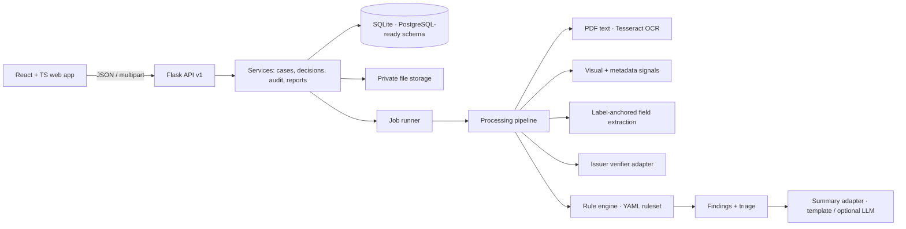
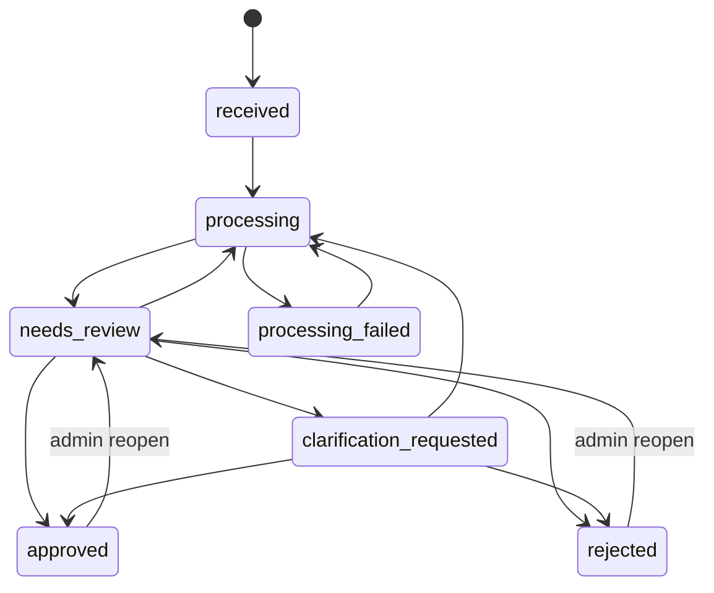

# Architecture

## Processing pipeline (per case run)

1. Each pending document: render pages, extract words with bounding boxes (native text, else OCR at 300 dpi).
2. Extract fields by matching `Label: value` lines against per-document label synonyms (fuzzy for OCR). Each value keeps page, bbox, source line and confidence.
3. Visual heuristics: ink density beside the last “Signature” label (printed words masked out), circular contour for seals, large type in the top band for letterheads.
4. Quality (blur, resolution, OCR confidence) and metadata (modification gap, incremental saves, editing tools) signals.
5. Issuer verifier records `NOT_VERIFIED` unless a real (or explicitly simulated) issuer confirms.
6. Rules run against *effective* values (reviewer correction wins). Findings are upserted by fingerprint `rule_id|version|subject`, so re-runs keep reviewer resolutions and clear findings that no longer apply.
7. Triage priority = weighted sum of open findings, with its components stored for display.
8. Summary: template always; LLM only if configured and its output passes guardrails.

## Case state machine

Invalid transitions return `409 INVALID_STATE`.

## Boundaries

- The rule engine is pure (no I/O): `CaseContext` in, `RuleResult` list out. This is what makes rules unit-testable with hand-built contexts.
- Storage, LLM, issuer verification and the job runner are adapters wired in `app/container.py`.
- Uploaded content is untrusted data throughout: never executed, never treated as instructions.
