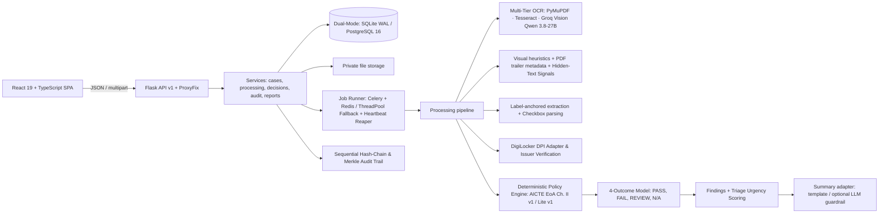
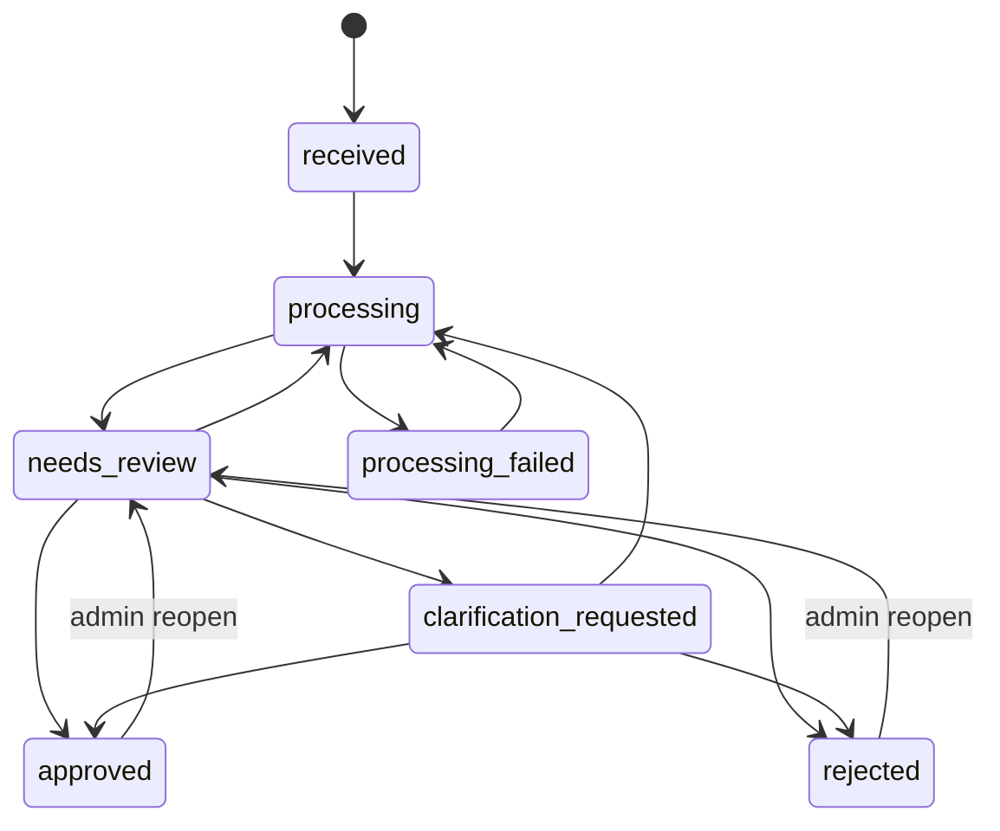

# VeriScope Architecture

## Processing Pipeline (Per Case Run)

1. **Document Intake & Hygiene**: MIME magic byte validation sniffs binary headers; SHA-256 digests identify cross-application file duplicates; password-encrypted or corrupt files are rejected. PDF page geometry is validated: pages with dimensions outside `36 pt` to `3400 pt` trigger `PAGE_SIZE_UNSUPPORTED`.
2. **Multi-Tier Text & Coordinate Extraction**:
   - Native vector text extracted via PyMuPDF (`fitz`) in sub-second time.
   - If native text is sparse (`< 25` characters) or document is an image, local Tesseract OCR processes pages at 300 DPI (with deferred rendering up to `12,000,000` pixels per page max).
   - If local OCR confidence is low or unavailable, Groq Vision OCR (`qwen/qwen3.8-27b`) is invoked via [`backend/app/processing/text.py`](../backend/app/processing/text.py).
   - Every word and entity retains normalized bounding box coordinates `(x1, y1, x2, y2)`.
3. **Field Extraction & Checkbox Detection**:
   - Matches `Label: value` lines against document-specific label synonyms.
   - Parses checkbox representations for statutory committee self-disclosures (Anti-Ragging, ICC, SGRC, SC/ST, IQAC, barrier-free access).
4. **Visual, Structural & Anti-Adversarial Forensics**:
   - Signature ink density analysis in bounding boxes adjacent to signature lines.
   - Circular geometric contour transforms for institutional seals.
   - PDF trailer dictionary parsing to identify incremental post-creation revisions.
   - Zero-contrast hidden text analysis flags low-contrast text as `hidden_text_detected` and isolates it into `hidden_words`.
5. **Issuer Verification & DigiLocker DPI Gateway**:
   - Default baseline status is `NOT_VERIFIED`.
   - In sandbox mode, DigiLocker imports retain `NOT_VERIFIED` status with `simulated: true` metadata and are restricted to authorized reviewers/admins.
   - Documents only advance to `ISSUER_VERIFIED` upon authentic national PKI certificate validation; heuristic string bypasses are prohibited.
6. **Dynamic Ruleset Routing & Policy Evaluation**:
   - Dynamic ruleset binding in [`backend/app/container.py`](../backend/app/container.py) routes `AICTE_EOA` cases to the 24-rule statutory catalogue (`aicte_eoa_chapter2.v1.yaml`) and prototype cases to `student_support_lite.v1.yaml`.
   - Rules evaluate effective values (human reviewer corrections override extracted values).
   - Rules output a typed 4-outcome breakdown (`PASS`, `FAIL`, `REVIEW_REQUIRED`, `NOT_APPLICABLE`).
   - Fail-closed execution: missing required documents/fields evaluate to `FAIL` or `REVIEW_REQUIRED`, never silent `PASS`.
7. **Finding Persistence & Idempotency**:
   - Discrepancies (`FAIL` and `REVIEW_REQUIRED`) are upserted into SQLite/PostgreSQL `findings` table by composite fingerprint `rule_id|version|subject`.
   - Re-running checks preserves human reviewer resolutions and waives, while stale findings that no longer trigger are marked inactive.
8. **Triage Prioritization**: Computes weighted urgency points based on open finding severities (`High = +40`, `Medium = +20`, `Low = +5`).
9. **AI Advisory Summary**: Template-based summary is always generated; advisory LLM summary is generated only if configured and verified against strict anti-hallucination guardrails.

---

## Case State Machine

Invalid state transitions return `409 INVALID_STATE`. Adjudication guards strictly block approval if unprocessed documents exist, evaluation is stale, or high-severity findings lack a >= 20 char reasoned waiver. Applicant uploads are blocked while in `needs_review`.

---

## Security & Deployment Architecture

- **Reverse-Proxy Rate Limiting**: In production deployments (`APP_ENV=prod`), Werkzeug's `ProxyFix` middleware (`x_for=1, x_proto=1, x_host=1, x_prefix=1`) ensures rate-limiting buckets evaluate client IPs accurately rather than reverse-proxy internal IPs.
- **Production Seed Protection & CLI Provisioning**: `scripts/seed.py` is prohibited from running in production environments unless explicitly authorized via `SEED_DEMO=true`. Production user creation is handled via `python -m scripts.create_user`.
- **Cryptographic Key Strengthening**: `Settings.from_env()` enforces a 32-byte secret key length in production, automatically strengthening short keys to 256-bit SHA-256 derived keys to satisfy RFC 7518 Section 3.2.
- **Dual-Layer Audit Immutability**:
  - Native database triggers (SQLite triggers and PostgreSQL PL/pgSQL function `audit_immutable_guard`) block `UPDATE` and `DELETE` on the `audit_events` table.
  - Sequential SHA-256 hash chaining (`seq`, `prev_hash`, `event_hash`) links each case audit entry, verifiable via `GET /api/v1/cases/<case_id>/audit/verify`.
  - Merkle tree notarization generates tamper-evident badges (`/audit/merkle`).
- **Heartbeat & Stale Background Job Reaper**:
  - The `jobs` table maintains a `heartbeat_at` timestamp.
  - An asynchronous background reaper and startup hook (`reap_stale_jobs()`) mark stranded jobs (>300s without heartbeat) as `FAILED`.

---

## Macro Compliance & Operations Analytics Architecture

- **SLA Telemetry Calculation**: Measures real-time reviewer turnaround times using database Julian-day calculations between case creation and official decision timestamps.
- **Systemic Statutory Deficiency Aggregator**: Groups active discrepancies by rule ID, severity, and official APH clause citation to provide AICTE leadership with macro insights into systemic non-compliance trends across technical colleges.
- **Three-Tier Trust State Telemetry**: Continuously tallies the proportion of documents at `NOT_VERIFIED`, `ANOMALY_DETECTED`, and `ISSUER_VERIFIED` to prevent premature claims of document authenticity.

---

## System Boundaries

- **Pure Rule Engine**: Evaluator functions take a `CaseContext` in and return a list of `RuleEvaluation` / `RuleResult` objects without database or network I/O.
- **Adapter Wiring**: File storage, Groq vision OCR, LLM summarization, and job execution are swappable interfaces wired via dependency injection in `app/container.py`.
- **Zero Verdict Authority for AI**: Machine learning and automated checks emit signals only; **binding determinations are reserved strictly for authorized human reviewers.**
