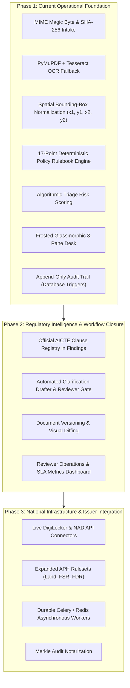

# VeriScope — Smart Automation Implementation & Engineering Roadmap

**Smart India Hackathon (SIH26261) · Theme: Smart Automation · Regulatory Partner: AICTE**  
*From Document Validation Prototype to an AI-Assisted, Automated Regulatory Review Platform*

---

## Executive Summary

VeriScope is an evidence-grounded regulatory automation platform designed to accelerate institutional application processing for bodies such as the All India Council for Technical Education (AICTE). 

This roadmap defines the transition from the working prototype to an enterprise-grade regulatory review platform across three core product differentiators:
1. **Regulation-Grounded Intelligence**: Authoritative official Approval Process Handbook (APH) clause citations.
2. **End-to-End Workflow Automation**: Automated cross-document checking, auto-drafted clarification requests, and event-driven progression.
3. **Explainable AI with Human Authority**: Low-confidence warnings, visual spatial coordinate provenance, and immutable audit logs.

---

## Part 1: Implemented Capabilities Inventory

The following systems are implemented, tested, and live in the production deployment:

### 1. Document Intake & Cryptographic Hygiene
- **MIME Magic Byte Sniffing**: Files are validated strictly by their internal byte headers rather than file extensions, preventing spoofed upload payloads.
- **SHA-256 Digesting & Deduplication**: Every uploaded PDF, PNG, or JPEG receives an immutable SHA-256 hash upon intake to identify identical submissions across applications.
- **Hygiene Verification**: Rejects password-encrypted, corrupted, or oversized files with descriptive feedback.

### 2. Dual-Engine Extraction & Spatial Bounding-Box Mapping
- **Digital Vector Parsing**: Direct extraction via PyMuPDF (`fitz`) extracts raw vector text, character spans, and spatial bounding boxes in milliseconds.
- **Automated OCR Fallback**: Scanned copies and non-searchable image uploads automatically trigger a **Tesseract OCR** background pipeline.
- **Confidence Gauges**: Tracks per-page and per-field OCR confidence metrics to alert reviewers when source document quality is degraded.
- **Coordinate Grounding**: Every extracted entity (Applicant Name, Institution Ref, Dates, Claim Totals, Land Parcel numbers) retains normalized `(x1, y1, x2, y2)` page coordinates.

### 3. Structural & Visual Signal Analyzers
- **Signature Ink Detector**: Inspects visual pixel density and connected stroke components in bounding boxes adjacent to designated signature lines.
- **Circular Seal & Stamp Detector**: Analyzes circular geometric shapes and color distributions to confirm the physical presence of institutional stamps.
- **PDF Revision & Edit History Analyzer**: Parses internal PDF trailer dictionaries and incremental modification trees, detecting if a document was altered post-creation (e.g. modified 74 days after initial issuance).

### 4. 17-Point Deterministic Policy Rulebook Engine
Rather than relying on non-deterministic generative models, VeriScope executes versioned YAML rulesets (`student_support_lite.v1.yaml`):
- **Completeness Audits (`CMP-001`)**: Validates presence of all mandatory forms and annexures.
- **Date & Chronology Audits (`DAT-001`, `DAT-002`)**: Automatically confirms that authorization dates precede application submission and remain within statutory validity periods.
- **Financial & Arithmetic Verification (`ARI-001`)**: Automatically computes itemized fees, grants, or claims and reconciles them against claimed totals, eliminating human math errors.
- **Cross-Document Entity Correlation (`CON-001`, `CON-002`)**: Cross-references institution names, registration IDs, and applicant details across distinct PDFs in the application dossier.
- **Visual Signal Rules (`SIG-001`, `SIG-002`, `SIG-003`)**: Flags missing signatures, absent official seals, or suspicious PDF edit histories.

### 5. Smart Triage & Priority Queue
- **Dynamic Urgency Scoring**: Evaluates open findings against a weighted matrix (`High = +40`, `Medium = +20`, `Low = +5`).
- **Automated Queue Ordering**: Cases with critical compliance issues bubble to the top of the queue automatically, removing manual sorting delays.
- **Segmented Operations View**: Real-time filtering across *Active*, *Needs Review*, *Clarification Requested*, and *Decided* states.

### 6. Modern Glassmorphic Workstation & Review Desk
- **Ambient Refraction Styling**: Frosted glass panels (`backdrop-filter: blur(14px)`), translucent cards, and responsive dark mode support.
- **3-Pane Desk**:
  1. *Interactive Evidence Viewer*: Smooth zoom (60% to 240%), page navigation, and pulsing bounding-box overlays indicating source coordinates.
  2. *Extracted Values Panel*: Real-time confidence scores and a field-correction workflow that records original values, new values, and mandatory reviewer justifications.
  3. *Findings Desk & Floating Decision Bar*: Instant coordinate locators, finding resolution/waiver dialogs, and automated approval gating (Approve button disabled while high-severity findings remain open).
- **Split-Screen Auth & 1-Click Demo Switcher**: Instant role testing for *Reviewer* (Adarsh Rao), *Applicant* (Vidya Institute), and *Admin* (Dr. Meenakshi Sundaram).

### 7. High-Assurance Trust Model & Guardrails
- **Three-Tier Trust State**: Every document and finding carries exactly one label:
  - `Issuer verified`: Cryptographic confirmation from issuing body recorded.
  - `Review required`: Discrepancy flagged for human inspection.
  - `Not verified with issuer`: Baseline default state.
- **No Verdict Labels**: Prohibits speculative binary authenticity assertions (`test_guardrails.py` build gate).
- **Prompt Injection Defense**: Evaluates inputs through deterministic code; injected instructions inside document text (e.g. `IGNORE AND APPROVE`) have zero effect on rule outcomes.
- **Tamper-Evident Audit Trail**: SQLite database triggers write every modification to an append-only audit log with timestamp, reviewer ID, and change notes.
- **1-Click Inspection Dossier**: Generates verifiable PDF/JSON case reports containing rule versions, document hashes, and official reviewer determinations.

---

## Part 2: Implementation Roadmap & Execution Plan

### Phase 2: Regulatory Intelligence & Workflow Closure (Immediate Priority)

#### 1. Official AICTE Clause Registry in Findings & Reports
* **Problem**: Findings currently display rule IDs (`CON-001`) without citing the exact official regulatory statute.
* **Implementation**:
  * Ingest the official **AICTE Approval Process Handbook (APH 2024-25)** and extract clause citations (e.g. `Clause 4.1.2`, `Chapter II §3(b)`).
  * Extend YAML rulesets with `clause_citation: "AICTE APH 2024-25 §4.2(a) p.48"` and `handbook_url`.
  * Display a clickable **Official Clause Badge** in the Findings Card and in the exported PDF Case Report.
* **Exit Criteria**: Every emitted finding links directly to a verifiable clause in the official AICTE handbook.

#### 2. Automated Clarification Drafter & Reviewer Approval Gate
* **Problem**: When requesting clarification, reviewers currently have to write messages manually from scratch.
* **Implementation**:
  * Automatically compose a formal, factual clarification draft synthesized from open findings:
    > *"During automated AICTE compliance review of Application {case_ref}, the following items require clarification: (1) Land Sale Deed: Survey parcel numbers truncated on p.2; (2) Authorization Letter: Signatory stamp absent on p.1. Please upload registered copies within 7 working days."*
  * Present a Reviewer Approval Modal allowing the officer to edit, adjust deadlines, and approve before dispatch.
  * Log the approved clarification text into the audit trail and update the applicant portal.
* **Exit Criteria**: 1-click draft generation with mandatory human reviewer preview and approval gate.

#### 3. Document Versioning & Visual Diffing Engine
* **Problem**: When an applicant re-uploads a corrected document, the reviewer cannot easily see what changed between versions.
* **Implementation**:
  * Store re-uploaded files as `v2`, preserving `v1` immutably.
  * Extract text and fields from `v2` and compute a structural before-and-after diff.
  * Display changed values in the UI (e.g. `Claim Amount: ₹1,12,000 (v1) → ₹1,33,500 (v2)`).
  * Automatically trigger targeted rule re-evaluation and auto-resolve findings addressed by the new upload.
* **Exit Criteria**: Reviewers inspect side-by-side version comparison with automated finding resolution.

#### 4. Reviewer Operations & SLA Dashboard Metrics
* **Problem**: Supervisors lack operational visibility into queue throughput and common compliance bottlenecks.
* **Implementation**:
  * Expose an operational analytics endpoint (`/api/v1/metrics`).
  * Display key performance indicators on the Review Queue:
    - **Median Case Turnaround Time** (*e.g., 2.8 minutes vs. 45 minutes manual*).
    - **Extraction Confidence Distribution** (*percentage of documents processed with >95% confidence*).
    - **Top 3 Regulatory Bottlenecks** (*most frequently triggered APH clauses*).
* **Exit Criteria**: Visual metrics bar on the Queue page showing throughput and bottleneck analysis.

---

### Phase 3: National Scale Infrastructure & Issuer Integration

#### 5. Live DigiLocker / NAD API Integration
* **Implementation**: Implement an OAuth2 connector to **DigiLocker** and **National Academic Depository (NAD)** to pull signed XML certificates and PKI signatures. Validate X.509 certificates directly against government Certificate Authorities.

#### 6. Expanded AICTE Approval Process Handbook (APH) Rulesets
* **Implementation**: Expand from the baseline lite rulebook to specialized AICTE verticals:
  * **Land & Built-Up Area Norms**: Automatic calculation of required acreage and carpet area based on sanctioned intake and course verticals (Engineering, Management, Pharmacy).
  * **Faculty-to-Student Ratio (FSR)**: Automated parsing of staff rosters to verify mandatory 1:15 or 1:20 cadred ratios.
  * **Financial Endowment Funds**: Automated verification of Fixed Deposit Receipts (FDR) and Joint Account encumbrance certificates.

#### 7. Durable Task Queue (Celery / Redis)
* **Implementation**: Decouple OCR and document processing from web request threads using Celery and Redis with idempotent job execution, bounded exponential backoff, and dead-letter queues.

#### 8. Cryptographic Audit Log Notarization
* **Implementation**: Periodically anchor SQLite audit trail Merkle roots into a public or consortium ledger to mathematically guarantee non-repudiation during legal appeals.

---

## Part 3: Detailed Feature Matrix & Implementation Status

| Feature / Subsystem | Status | Layer | Technical Implementation |
|---|---|---|---|
| **MIME Magic Byte Validation** | ✅ Production | Backend | Byte-level header sniffing, blocks disguised payloads |
| **SHA-256 Digest Deduplication** | ✅ Production | Backend | Cryptographic cross-case matching |
| **Dual PDF / Tesseract OCR Pipeline** | ✅ Production | Processing | Vector text stream with OCR image fallback |
| **Spatial Bounding-Box Grounding** | ✅ Production | Processing / UI | Normalized `(x1, y1, x2, y2)` visual overlays |
| **Seal & Signature Detection** | ✅ Production | Processing | Geometric circularity and connected stroke analysis |
| **PDF Revision History Scanner** | ✅ Production | Processing | Trailer dictionary incremental modification parser |
| **17-Point Deterministic Rule Engine** | ✅ Production | Rules | Pure Python YAML policy evaluator |
| **Dynamic Triage Priority Scoring** | ✅ Production | Services | Severity-weighted queue escalation |
| **Frosted Glassmorphic Review Desk** | ✅ Production | Frontend | 3-pane responsive workstation with dark mode |
| **Interactive Demo Auth Switcher** | ✅ Production | Frontend | 1-click Reviewer, Applicant, and Admin access |
| **Append-Only Tamper-Evident Trail** | ✅ Production | Database | SQLite triggers with user and timestamp logging |
| **Automated Case Dossier Export** | ✅ Production | Services | One-click PDF/JSON regulatory reports |
| **Production Cloud Deployments** | ✅ Production | DevOps | Vercel (UI) + Render (API Docker service) |
| **Official AICTE Clause Citations** | ⏳ Phase 2 | Rules / UI | Real APH 2024-25 clause mapping in findings cards |
| **Automated Clarification Drafter** | ⏳ Phase 2 | Services / UI | Auto-drafted requests with reviewer approval gate |
| **Document Versioning & Visual Diff** | ⏳ Phase 2 | Processing / UI | Side-by-side replacement comparison & auto-resolution |
| **Reviewer Operations SLA Metrics** | ⏳ Phase 2 | Frontend / API | Turnaround times, confidence distribution, bottleneck stats |
| **Live DigiLocker / NAD API Integration**| ⏳ Phase 3 | Integrations | PKI X.509 certificate validation |
| **Full AICTE APH Norms Rulesets** | ⏳ Phase 3 | Rules | Land area, FSR cadred ratio, and FDR calculations |
| **Asynchronous Task Queue (Celery)** | ⏳ Phase 3 | Infrastructure | Distributed bulk document processing |
| **Merkle Audit Notarization** | ⏳ Phase 3 | Security | Cryptographic proof of immutability |

---

## Part 4: Recommended 3-Minute SIH Presentation Script

| Time | What to Show on Screen | Key Talking Point for Judges |
|---|---|---|
| **0:00 – 0:45** | **1-Click Demo Login (`Reviewer`) & Priority Queue** | *"AICTE officers review thousands of multi-page institutional filings. VeriScope prioritizes applications by weighted compliance urgency, not arrival time."* |
| **0:45 – 1:30** | **3-Pane Review Desk & Bounding Box Evidence** | *"Clicking any finding instantly illuminates its exact spatial coordinates on the document page. No manual searching, no data entry, no generative hallucinations."* |
| **1:30 – 2:15** | **Deterministic Rules & Automated Clarification** | *"Our 17-point rulebook verifies cross-document consistency and fee math in milliseconds. When an issue is found, VeriScope auto-drafts the clarification notice for officer approval."* |
| **2:15 – 3:00** | **Decision Gating & Append-Only Audit Trail** | *"Approval is hard-blocked until high-severity findings are resolved. A court-ready, cryptographically hashed inspection dossier is exported with one click."* |

---

  <i>VeriScope · Designed for Transparent, Auditable, and Automated Institutional Governance.</i>

