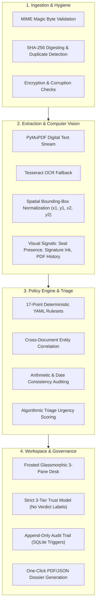
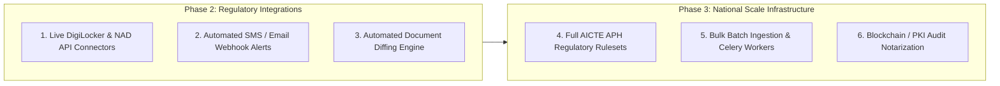

# VeriScope — Smart Automation Implementation & Engineering Roadmap

**SIH26261 · AICTE · Smart Automation**  
*AI-Powered Application Validation, Document Authentication & Regulatory Compliance Desk*

---

## Executive Summary

VeriScope is an evidence-grounded regulatory automation platform designed to streamline and accelerate institutional application processing for bodies such as the All India Council for Technical Education (AICTE). 

This document provides a comprehensive inventory of:
1. **Implemented Capabilities**: Systems, pipelines, deterministic engines, security guardrails, and user interfaces already built, tested, and deployed to production.
2. **Planned Roadmap**: High-impact extensions scheduled for future phases (live DigiLocker integration, automated document diffing, webhook alerts, and expanded Approval Process Handbook rulesets).

---

## Part 1: Implemented Capabilities (What We Built)

### 1. Automated Document Ingestion & Hygiene Pipeline
- **MIME Magic Byte Inspection**: Documents are evaluated strictly by their internal byte headers rather than file extensions, preventing spoofed upload payloads.
- **Cryptographic SHA-256 Digesting**: Every uploaded PDF, PNG, or JPEG receives an immutable SHA-256 hash upon intake.
- **Cross-Application Deduplication**: Detects when byte-identical files (such as institutional registration certificates or affidavits) are re-used across different applicant records.
- **Hygiene & Safety Verification**: Rejects password-encrypted, corrupted, or oversized files prior to processing with actionable user alerts.

### 2. Dual-Engine Extraction & Spatial Bounding-Box Mapping
- **Digital Vector Parsing**: Direct extraction via PyMuPDF (`fitz`) extracts raw vector text, character spans, and spatial bounding boxes in milliseconds.
- **Automated OCR Fallback**: Scanned copies and non-searchable image uploads automatically trigger a **Tesseract OCR** background pipeline.
- **Confidence Gauges**: Tracks per-page and per-field OCR confidence metrics to alert reviewers when source document quality is degraded.
- **Coordinate Grounding**: Every extracted entity (Applicant Name, Institution Ref, Dates, Claim Totals, Land Parcel numbers) retains normalized `(x1, y1, x2, y2)` page coordinates.

### 3. Visual & Structural Signal Analyzers
- **Signature Ink Detector**: Inspects visual pixel density and connected stroke components in bounding boxes adjacent to designated signature lines.
- **Circular Seal & Stamp Detector**: Analyzes circular geometric shapes and color distributions to confirm the physical presence of institutional stamps.
- **PDF Revision & Edit History Analyzer**: Parses internal PDF trailer dictionaries and incremental modification trees, detecting if a document was altered post-creation (e.g. modified 74 days after initial issuance).

### 4. 17-Point Deterministic Policy Rulebook Engine
Rather than relying on non-deterministic generative models, VeriScope executes versioned YAML rulesets (`student_support_lite.v1.yaml`):
- **Completeness Audits (`CMP-001`)**: Validates presence of all mandatory forms and annexures.
- **Date & Chronology Audits (`DAT-001`, `DAT-002`)**: Automatically confirms that authorization dates precede application submission and remain within statutory validity periods.
- **Financial & Arithmetic Verification (`ARI-001`)**: Automatically computes itemized fees, grants, or claims and reconciles them against claimed totals, eliminating human math errors.
- **Cross-Document Entity Correlation (`CON-001`, `CON-002`)**: Cross-references institution names, registration IDs, and applicant details across distinct PDFs in the application dossier.
- **Visual Signal Rules (`SIG-001`, `SIG-002`, `SIG-003`)**: Flags missing signatures, absent official seals, or suspicious PDF edit histories.

### 5. Smart Triage & Priority Queue
- **Dynamic Urgency Scoring**: Evaluates open findings against a weighted matrix (`High = +40`, `Medium = +20`, `Low = +5`).
- **Automated Queue Ordering**: Cases with critical compliance issues bubble to the top of the queue automatically, removing manual sorting delays.
- **Segmented Operations View**: Real-time filtering across *Active*, *Needs Review*, *Clarification Requested*, and *Decided* states.

### 6. Modern Glassmorphic Workstation & Review Desk
- **Ambient Refraction Styling**: Frosted glass panels (`backdrop-filter: blur(14px)`), translucent cards, and responsive dark mode support.
- **3-Pane Desk**:
  1. *Interactive Evidence Viewer*: Smooth zoom (60% to 240%), page navigation, and pulsing bounding-box overlays indicating source coordinates.
  2. *Extracted Values Panel*: Real-time confidence scores and a field-correction workflow that records original values, new values, and mandatory reviewer justifications.
  3. *Findings Desk & Floating Decision Bar*: Instant coordinate locators, finding resolution/waiver dialogs, and automated approval gating (Approve button disabled while high-severity findings remain open).
- **Split-Screen Auth & 1-Click Demo Switcher**: Instant role testing for *Reviewer* (Adarsh Rao), *Applicant* (Vidya Institute), and *Admin* (Dr. Meenakshi Sundaram).

### 7. High-Assurance Trust Model & Guardrails
- **Three-Tier Trust State**: Every document and finding carries exactly one label:
  - `Issuer verified`: Cryptographic confirmation from issuing body recorded.
  - `Review required`: Discrepancy flagged for human inspection.
  - `Not verified with issuer`: Baseline default state.
- **No Verdict Labels**: Prohibits speculative binary authenticity assertions (`test_guardrails.py` build gate).
- **Prompt Injection Defense**: Evaluates inputs through deterministic code; injected instructions inside document text (e.g. `IGNORE AND APPROVE`) have zero effect on rule outcomes.
- **Tamper-Evident Audit Trail**: SQLite database triggers write every modification to an append-only audit log with timestamp, reviewer ID, and change notes.
- **1-Click Inspection Dossier**: Generates verifiable PDF/JSON case reports containing rule versions, document hashes, and official reviewer determinations.

### 8. Production CI/CD & Deployments
- **Frontend**: Live on **Vercel** with automatic deployment triggers from `main`.
- **Backend API**: Containerized Docker service deployed on **Render** with dynamic port handling and CORS preflight negotiation.
- **Automated CI Pipeline**: GitHub Actions running backend pytest suites, frontend TypeScript type-checking, Vite production bundling, Docker container builds, and Playwright end-to-end browser walkthroughs.

---

## Part 2: Roadmap & Future Work (What Needs To Be Done)

The following high-impact initiatives represent the planned evolution of VeriScope for regulatory scaling:

### 1. Live Government Issuer Integration (DigiLocker / API Setu / NAD)
* **Objective**: Transition documents from `Not verified with issuer` to authenticated `Issuer verified` state.
* **Architecture**:
  * Implement an OAuth2 connector to **DigiLocker** and **National Academic Depository (NAD)**.
  * Pull signed XML certificates and PKI signatures for institutional registration, land records, and accreditation certificates.
  * Validate X.509 digital certificates directly against government Certificate Authorities (CAs).

### 2. Automated Clarification Notifications (Webhooks / Email / SMS)
* **Objective**: Streamline back-and-forth communication when a reviewer requests clarification.
* **Architecture**:
  * Add an asynchronous webhook dispatcher in `backend/app/services/notifications.py`.
  * Automatically email the institution registrar with the reviewer's exact instructions and a direct one-click upload link.
  * Support SMS gateway integration (NIC / CDAC SMS portal) for urgent application deadline alerts.

### 3. Automated Document Diffing Engine (Old vs. New Visual Comparison)
* **Objective**: When an applicant re-uploads a corrected document in response to clarification, automatically highlight differences.
* **Architecture**:
  * Compute structural diffs between original and replaced PDF versions.
  * Render an interactive side-by-side comparison pane in the Evidence Viewer.
  * Visually highlight added, deleted, or modified text blocks and stamp regions.

### 4. Full AICTE Approval Process Handbook (APH) Rulesets
* **Objective**: Expand the policy library from the baseline prototype ruleset to comprehensive regulatory verticals.
* **Ruleset Expansions**:
  * **Land & Built-Up Area Norms**: Automatic calculation of required acreage and carpet area based on sanctioned intake and course verticals (Engineering, Management, Pharmacy).
  * **Faculty-to-Student Ratio (FSR)**: Automated parsing of staff rosters to verify mandatory 1:15 or 1:20 cadred ratios.
  * **Financial Endowment Funds**: Automated verification of Fixed Deposit Receipts (FDR) and Joint Account encumbrance certificates.

### 5. High-Throughput Batch Ingestion & Asynchronous Job Workers
* **Objective**: Support bulk ingestion during peak national admission and approval windows.
* **Architecture**:
  * Decouple OCR and PDF processing from the web worker using Celery and Redis.
  * Support bulk ZIP/CSV package ingestion for state-level or university-wide submissions.
  * Horizontal worker autoscaling to handle thousands of pages concurrently.

### 6. Cryptographic Audit Log Notarization
* **Objective**: Guarantee non-repudiation of reviewer determinations in legal disputes.
* **Architecture**:
  * Periodically anchor SQLite audit trail Merkle roots into a public or consortium ledger (e.g. IndiaChain / Hyperledger).
  * Enable external auditors to mathematically prove that no audit event was altered or deleted.

---

## Part 3: Feature Matrix & Status Summary

| Capability | Status | Component | Details |
|---|---|---|---|
| MIME Magic Byte Validation | ✅ Production | Backend | Native header sniffing |
| SHA-256 Digest Deduplication | ✅ Production | Backend | Cryptographic cross-case matching |
| Hybrid PDF / Tesseract Extraction | ✅ Production | Processing | Vector text + OCR fallback |
| Spatial Bounding-Box Grounding | ✅ Production | Processing / UI | Normalized `(x1, y1, x2, y2)` overlays |
| Seal & Signature Detection | ✅ Production | Processing | OpenCV / geometric stroke analysis |
| PDF Edit History Analysis | ✅ Production | Processing | Trailer dictionary anomaly scanner |
| 17-Point Deterministic Rule Engine | ✅ Production | Rules | Pure Python YAML policy evaluator |
| Algorithmic Triage Risk Scoring | ✅ Production | Services | Severity-weighted queue ordering |
| Frosted Glassmorphism Review Desk | ✅ Production | Frontend | 3-pane interactive workstation |
| Responsive Dark / Light Mode | ✅ Production | Frontend | CSS token variables & ambient mesh |
| One-Click Demo Auth Switcher | ✅ Production | Frontend | Pre-configured Reviewer/Applicant/Admin |
| Append-Only Audit Trail | ✅ Production | Database | SQLite triggers with user tracking |
| Automated PDF/JSON Case Reports | ✅ Production | Services | One-click regulatory dossier export |
| Production Cloud Deployments | ✅ Production | DevOps | Vercel (UI) + Render (API) |
| Live DigiLocker / NAD API Integration | ⏳ Roadmap (Phase 2) | Integrations | PKI / Government OAuth2 connector |
| Automated Email / SMS Dispatch | ⏳ Roadmap (Phase 2) | Services | Webhook event notifications |
| Side-by-Side Visual Diffing | ⏳ Roadmap (Phase 2) | Frontend / Vision | Document version comparison |
| Full AICTE APH Norms Ruleset | ⏳ Roadmap (Phase 3) | Rules | Land, FSR, and FDR calculation rules |
| Asynchronous Batch Queue (Celery) | ⏳ Roadmap (Phase 3) | Infrastructure | Distributed bulk document ingestion |
| Merkle Notarization of Audit Log | ⏳ Roadmap (Phase 3) | Security | Cryptographic proof of immutability |

---

  <i>VeriScope · Designed for Transparent, Auditable, and Automated Institutional Governance.</i>

