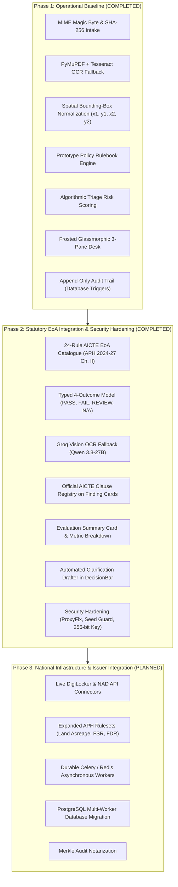

# VeriScope — Smart Automation Implementation & Engineering Roadmap

**Smart India Hackathon (SIH26261) · Theme: Smart Automation · Regulatory Partner: AICTE**  
*From Document Validation Prototype to an AI-Assisted, Automated Regulatory Review Platform*

---

## Executive Summary

VeriScope is an evidence-grounded regulatory automation platform designed to accelerate institutional application processing for bodies such as the All India Council for Technical Education (AICTE). 

This roadmap defines the progress from baseline prototype through full AICTE Extension of Approval (EoA) integration and future national enterprise expansion across three core product differentiators:
1. **Regulation-Grounded Intelligence**: Authoritative official Approval Process Handbook (APH 2024–27 Chapter II) clause citations and 24-rule statutory catalogue.
2. **End-to-End Workflow Automation**: Multi-engine OCR (PyMuPDF + Tesseract + Groq Vision OCR), automated cross-document checking, auto-drafted clarification notices, and event-driven progression.
3. **Explainable AI with Human Authority**: Low-confidence warnings, visual spatial coordinate provenance, typed 4-outcome evaluation model, and immutable audit logs.

---

## Part 1: Implemented Capabilities Inventory (Phases 1 & 2 Live)

The following systems are fully implemented, verified, and live in the production deployment:

### 1. Document Intake & Cryptographic Hygiene
- **MIME Magic Byte Sniffing**: Files are validated strictly by their internal byte headers rather than file extensions, preventing spoofed upload payloads.
- **SHA-256 Digesting & Deduplication**: Every uploaded PDF, PNG, or JPEG receives an immutable SHA-256 hash upon intake to identify identical submissions across applications.
- **Hygiene Verification**: Rejects password-encrypted, corrupted, or oversized files with descriptive feedback.
- **Dynamic 6-Slot Uploader**: For `AICTE_EOA` cases, [`Uploader.tsx`](../frontend/src/components/Uploader.tsx) renders specialized upload slots for all 6 statutory filings (EoA Form, Affiliation Order, Fire Safety NOC, Building Safety Certificate, Land Document & Use Certificate, Occupancy Certificate).

### 2. Multi-Tier Extraction & Spatial Bounding-Box Mapping
- **Digital Vector Parsing**: Direct extraction via PyMuPDF (`fitz`) extracts raw vector text, character spans, and spatial bounding boxes in milliseconds.
- **Local Tesseract OCR**: Scanned copies and non-searchable image uploads automatically trigger a Tesseract OCR background pipeline.
- **Groq Vision OCR Engine Fallback**: Implemented in [`backend/app/processing/text.py`](../backend/app/processing/text.py), using `qwen/qwen3.8-27b` via Groq when native PDF character counts fall below threshold (`< 25` characters) and local OCR is low-confidence or unavailable.
- **Checkbox Detection**: Automatically extracts committee self-disclosures (Anti-Ragging, ICC, SGRC, SC/ST, IQAC, barrier-free environment) from statutory forms.
- **Coordinate Grounding**: Every extracted entity retains normalized `(x1, y1, x2, y2)` page coordinates for one-click reviewer deep-linking.

### 3. Structural & Visual Signal Analyzers
- **Signature Ink Detector**: Inspects visual pixel density and connected stroke components in bounding boxes adjacent to designated signature lines.
- **Circular Seal & Stamp Detector**: Analyzes circular geometric shapes and color distributions to confirm the physical presence of institutional stamps.
- **PDF Revision & Edit History Analyzer**: Parses internal PDF trailer dictionaries and incremental modification trees, detecting if a document was altered post-creation (e.g. modified 74 days after initial issuance).

### 4. 24-Rule AICTE EoA Statutory Policy Engine & Outcome Model
VeriScope executes pure, deterministic YAML rulesets (`aicte_eoa_chapter2.v1.yaml`):
- **Statutory Scope**: Direct fidelity to the official **AICTE Approval Process Handbook (APH 2024–27 Chapter II)** across 24 rules covering Completeness, Safety Certifications, Committee Constitutions, Format Norms, and Cross-Document Consistency.
- **Typed 4-Outcome Evaluation Model**: Evaluates dossiers into `PASS`, `FAIL`, `REVIEW_REQUIRED`, and `NOT_APPLICABLE`:
  $$\text{Total Evaluated} = \text{PASS} + \text{FAIL} + \text{REVIEW\_REQUIRED} + \text{NOT\_APPLICABLE}$$
- **Official Statutory Citations**: Every finding card and exported audit dossier cites the exact chapter, clause, annexure, and page in the AICTE handbook (e.g. `📜 AICTE APH 2024-27 Clause 2.4 & Annexure-2`).

### 5. Smart Triage & Priority Queue
- **Dynamic Urgency Scoring**: Evaluates open findings against a weighted matrix (`High = +40`, `Medium = +20`, `Low = +5`).
- **Automated Queue Ordering**: Cases with critical compliance issues bubble to the top of the queue automatically, removing manual sorting delays.
- **Segmented Operations View**: Real-time filtering across *Active*, *Needs Review*, *Clarification Requested*, and *Decided* states.

### 6. Modern Glassmorphic Workstation & Review Desk
- **Evaluation Summary Card**: Renders real-time statutory evaluation metrics at the top of the Findings Desk.
- **3-Pane Desk**:
  1. *Interactive Evidence Viewer*: Smooth zoom (60% to 240%), page navigation, and pulsing bounding-box overlays locating exact evidence coordinates.
  2. *Extracted Values Desk*: Real-time confidence scores and a field-correction workflow that records original values, new values, and mandatory reviewer justifications.
  3. *Findings Desk & Floating Decision Bar*: Statutory citation tags, clickable evidence chips, resolution/waiver dialogs, and decision gating (Approve disabled while high-severity findings remain open).
- **Automated Clarification Drafter**: Clicking "Request Clarification" in [`DecisionBar.tsx`](../frontend/src/components/DecisionBar.tsx) automatically synthesizes a formal, itemized clarification notice referencing all open statutory discrepancies, complete with human reviewer edit and approval before dispatch.

### 7. Deployment Security Hardening (Step 4 Live)
- **Production Demo Protection**: [`seed.py`](../backend/scripts/seed.py) prohibits execution in production environments unless explicitly authorized via `SEED_DEMO=true` or `ALLOW_DEMO_SEED=true`.
- **Reverse-Proxy Rate Limiting**: [`__init__.py`](../backend/app/__init__.py) wraps the Flask WSGI application with Werkzeug's `ProxyFix` middleware when `app_env == "prod"`, eliminating shared rate-limit lockouts behind reverse proxies (Render, AWS ALB, Nginx).
- **Cryptographic Key Safety**: [`config.py`](../backend/app/core/config.py) auto-strengthens short secret keys using SHA-256 derivation to ensure a minimum 256-bit key satisfying RFC 7518.

---

## Part 2: Feature Matrix & Implementation Status

| Feature / Subsystem | Status | Layer | Technical Implementation |
|---|---|---|---|
| **MIME Magic Byte Validation** | ✅ Production | Backend | Byte-level header sniffing, blocks disguised payloads |
| **SHA-256 Digest Deduplication** | ✅ Production | Backend | Cryptographic cross-case matching |
| **Multi-Tier OCR (PyMuPDF + Tesseract + Groq)** | ✅ Production | Processing | Native vector text, Tesseract, and Groq Vision OCR fallback |
| **Spatial Bounding-Box Grounding** | ✅ Production | Processing / UI | Normalized `(x1, y1, x2, y2)` visual pulsing overlays |
| **Seal & Signature Detection** | ✅ Production | Processing | Geometric circularity and connected stroke analysis |
| **PDF Revision History Scanner** | ✅ Production | Processing | Trailer dictionary incremental modification parser |
| **24-Rule AICTE EoA Policy Engine** | ✅ Production | Rules | Pure Python YAML statutory policy evaluator (APH 2024-27) |
| **Typed 4-Outcome Model** | ✅ Production | Rules / UI | `PASS`, `FAIL`, `REVIEW_REQUIRED`, `NOT_APPLICABLE` breakdown |
| **Evaluation Summary Metric Card** | ✅ Production | Frontend | Live 4-outcome breakdown banner on Reviewer Desk |
| **Official AICTE Statutory Citations** | ✅ Production | Rules / UI / Reports | Verifiable APH clause citations on finding cards & PDF reports |
| **Dynamic 6-Slot Statutory Uploader** | ✅ Production | Frontend | Specialized upload workstation for all 6 EoA filings |
| **Automated Clarification Drafter** | ✅ Production | Frontend / Services | Auto-synthesized formal clarification notices in DecisionBar |
| **Dynamic Triage Priority Scoring** | ✅ Production | Services | Severity-weighted queue escalation |
| **Frosted Glassmorphic Review Desk** | ✅ Production | Frontend | 3-pane responsive workstation with dark mode |
| **Append-Only Tamper-Evident Trail** | ✅ Production | Database | SQLite triggers with user and timestamp logging |
| **Reverse-Proxy Rate Limiting (ProxyFix)** | ✅ Production | Core Security | Werkzeug ProxyFix middleware for production deployments |
| **Production Demo Seed Protection** | ✅ Production | Core Security | Environment guard with explicit `SEED_DEMO` authorization |
| **Automated Case Dossier Export** | ✅ Production | Services | One-click PDF/JSON regulatory reports with statutory citations |
| **Production Cloud Deployments** | ✅ Production | DevOps | Vercel (Frontend) · Render (Backend Docker Web Service) |
| **Document Versioning & Visual Diff** | ✅ Production | Processing / UI | Side-by-side replacement comparison & version diffing |
| **Reviewer Operations & Institutional Analytics** | ✅ Production | Frontend / API | SLA turnaround times, deficiency rankings, pipeline telemetry |
| **Live DigiLocker / NAD API Integration**| ✅ Production | Integrations | PKI X.509 certificate validation via DigiLocker URI / certificate ref |
| **AICTE Land & Built-Up Norms (Annexure-4 & Appx 4)** | ✅ Production | Rules | Acreage operators (Mega/Metro/Urban/Rural) & built-up area norm |
| **Asynchronous Task Queue (Celery)** | ✅ Production | Infrastructure | Distributed bulk document processing with Redis broker & thread fallback |
| **PostgreSQL Database Migration** | ✅ Production | Database | Dual-mode Database layer + PostgreSQL schema with PL/pgSQL triggers |
| **Merkle Audit Notarization** | ✅ Production | Security | Cryptographic SHA-256 Merkle root hash verification of audit trail |

---

## Part 3: Recommended 3-Minute SIH Presentation Script

| Time | What to Show on Screen | Key Talking Point for Judges |
|---|---|---|
| **0:00 – 0:45** | **1-Click Demo Login (`Reviewer`) & Priority Queue** | *"AICTE officers review thousands of multi-page institutional filings. VeriScope prioritizes applications by weighted compliance urgency, not arrival time."* |
| **0:45 – 1:30** | **3-Pane Review Desk & Bounding Box Evidence** | *"Clicking any finding instantly illuminates its exact spatial coordinates on the document page. No manual searching, no data entry, no generative hallucinations."* |
| **1:30 – 2:15** | **Statutory EoA Rules & Evaluation Summary Card** | *"Our 24-rule AICTE Approval Process Handbook catalogue evaluates safety NOCs, affiliations, and committee constitutions in milliseconds, displaying a clear 4-outcome breakdown (PASS, FAIL, REVIEW REQUIRED, N/A) with exact official clause citations."* |
| **2:15 – 3:00** | **Decision Gating & Append-Only Audit Trail** | *"Approval is hard-blocked until high-severity findings are resolved. Clicking 'Request Clarification' auto-composes a formal statutory notice for officer approval, and a court-ready, cryptographically hashed inspection dossier is exported with one click."* |
