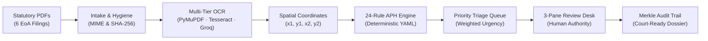

# Veriscope — SIH 2026 Final Slide Copy

## Slide 1: Title Page

### Exact slide-ready content

**VERISCOPE**  
AI-Powered Smart Automation Copilot for Institutional Validation & Regulatory Compliance

- **Event:** Smart India Hackathon 2026
- **Problem Statement ID:** 26261
- **Problem Statement Title:** AI Powered Application Validation, Document Authentication and Regulatory Compliance Verification
- **Theme:** Smart Automation
- **Category:** Software
- **Team ID:** SIH/2026/94
- **Team Name:** Indriya
- **Project Name:** Veriscope

### Recommended layout
Centered high-contrast header with Veriscope branding prominently placed above a clean two-column metadata card, balanced by the official SIH and Team Indriya logos in the top header corners.

---

## Slide 2: Idea Title and Proposed Solution

### Exact slide-ready content

**Idea Title: Veriscope — Smart Automation Reviewer Copilot**

- **Regulatory Bottleneck:** Manual cross-referencing of multi-page institutional filings causes severe review backlogs, cognitive fatigue, and missed compliance discrepancies.
- **Proposed Solution:** Evidence-grounded reviewer copilot pairing multi-tier OCR with a 24-rule deterministic AICTE statutory policy engine.
- **Core Workflow:** Intake 6 Statutory PDFs → Multi-Tier Text Extraction → 24-Rule APH Audit → 3-Pane Review Desk.
- **Key Differentiator:** Spatial coordinate provenance `(x1, y1, x2, y2)` visually deep-links every rule finding to source document pixels.
- **Novelty:** Pure deterministic execution eliminates generative AI hallucinations and prompt injections while safeguarding human administrative authority.

### Recommended visual
A three-stage horizontal pipeline diagram: **Manual Regulatory Bottleneck (Red)** → **Veriscope Grounded Copilot (Teal)** → **Objective, Fast Compliance Determination (Green)**, accompanied by an annotated UI badge showing the 4-outcome breakdown (`18 PASS | 3 FAIL | 2 REVIEW | 2 N/A`).

---

## Slide 3: Technical Approach

### Exact slide-ready content

**Technical Approach: Architecture & Methodology**

- **Technology Stack:** React 19 TypeScript frontend, Python 3.12 Flask REST API, dual-mode SQLite / PostgreSQL 16 persistence.
- **Multi-Tier Extraction:** Native PyMuPDF vector parsing with automatic fallback to local Tesseract OCR and Groq Vision (`qwen/qwen3.8-27b`).
- **Deterministic Policy Engine:** Pure Python engine evaluating 24 statutory rules into typed outcomes (`PASS`, `FAIL`, `REVIEW REQUIRED`, `NOT APPLICABLE`).
- **Forensics & Audit:** Detects PDF revision anomalies, signature ink density, and maintains an append-only SHA-256 Merkle audit trail.
- **Decision Gating:** Administrative state machine hard-blocks case approval while unresolved high-severity statutory findings remain open.

### Recommended visual
A linear architecture flow showing document ingestion, multi-tier OCR routing, deterministic policy evaluation, and the 3-pane review desk, paired with a small screenshot callout of the pulsing evidence bounding-box overlay.

### Diagram specification

---

## Slide 4: Feasibility and Viability

### Exact slide-ready content

**Feasibility and Viability: Engineering & Operational Resilience**

- **Technical Feasibility:** Fully functional containerized prototype with 153 passing automated tests covering extraction, policy rules, and security.
- **Scan Quality Mitigation:** Degraded scans below 80% OCR confidence automatically trigger `EOA-SIG-002` for flagged human review.
- **Adversarial Resilience:** Zero-contrast color analysis isolates hidden prompt injections; Werkzeug `ProxyFix` ensures secure reverse-proxy rate limiting.
- **Regulatory Adaptability:** Versioned YAML rulesets allow instant updates to new annual handbooks without backend application code changes.
- **Operational Integration:** Operates as a non-disruptive copilot for AICTE scrutiny desks; documents default to verifiable `NOT_VERIFIED` trust status.

### Recommended visual
A compact 2x2 comparison grid contrasting real-world operational challenges (*Degraded Scans*, *Adversarial Text*, *Changing Regulations*, *Workflow Integration*) directly with Veriscope's implemented architectural safeguards.

---

## Slide 5: Impact and Benefits

### Exact slide-ready content

**Impact and Benefits: Measurable Regulatory Governance**

- **Target Beneficiaries:** AICTE scrutiny committees, regional directors, institutional registrars, and students reliant on mandatory campus safety norms.
- **Operational Acceleration:** Slashes multi-hour manual document cross-referencing into an assisted review completed in minutes per dossier.
- **Administrative Due Process:** Auto-synthesizes formal clarification notices citing exact APH clauses, eliminating arbitrary rejections and legal disputes.
- **Macro Telemetry:** Live operations dashboard tracks scrutiny turnaround time (TAT) SLAs and ranks systemic institutional non-compliance trends.
- **Proposed Pilot Metrics:** Mean review turnaround reduction (>75%), rule discrepancy detection recall, and 100% cryptographic audit verification.

### Recommended visual
A split layout: Left side showing the **Causal Impact Chain** (*Multi-Tier Extraction → 3-Pane Review Workstation → Hours-to-Minutes Defensible Decisions*); Right side featuring a metric telemetry mockup illustrating Turnaround Time (TAT) SLA reduction and clause ranking.

---

## Slide 6: Research and References

### Exact slide-ready content

**Research and References: Statutory & Technical Foundations**

- **AICTE Approval Process Handbook (2024–27):** Chapter II Extension of Approval procedures and Annexure-2 mandatory document requirements.
- **Administrative Due Process (Article 14):** Constitutional requirement for evidence-backed reasoned orders (*Maneka Gandhi v. UOI*, 1978).
- **Document Layout & Extraction:** PyMuPDF vector stream architecture and Tesseract OCR engine (*Smith, IEEE ICDAR 2007*).
- **Cryptographic Immutability:** Sequential SHA-256 hash chaining and Merkle audit trees (*Merkle, IEEE S&P 1979*; RFC 7518).
- **Digital Public Infrastructure:** National e-Governance Division (NeGD) DigiLocker and National Academic Depository (NAD) API specifications.

### Recommended visual
A scholarly four-quadrant reference grid grouping citations into: (1) Statutory Authorities, (2) Constitutional Due Process, (3) Computer Vision & Document AI, and (4) Cryptographic & DPI Standards.

---

## Supporting Material — Not for Direct Placement on Slides

### 1. Presenter Notes for Each Slide

#### Slide 1: Title Page
> "Good morning, respected judges. We represent Team Indriya, presenting Veriscope for Problem Statement 26261 under Smart Automation. Every year, statutory bodies like the AICTE must scrutinize tens of thousands of complex institutional accreditation files—cross-referencing land deeds, municipal fire NOCs, and university orders. Veriscope provides an evidence-grounded review copilot that automates extraction, checking, and audit trails while keeping legal authority strictly in the hands of human scrutiny officers."

#### Slide 2: Idea Title and Proposed Solution
> "When technologists try to automate document scrutiny, they usually deploy unconstrained generative AI, which hallucinates rules, or black-box computer vision models that output unexplainable suspicion scores. Under Article 14 of the Constitution of India, an administrative body cannot reject an institution based on an opaque machine score. Veriscope takes a fundamentally different path: we combine multi-tier OCR with 24 deterministic rules drawn directly from the AICTE Approval Process Handbook. Clicking any rule finding instantly illuminates its exact pixel coordinates on the document page, giving officers speed without sacrificing due process."

#### Slide 3: Technical Approach
> "Architecturally, Veriscope is built for production resilience. Our intake pipeline routes documents through PyMuPDF for sub-second vector extraction, Tesseract for local scans, and Groq Vision (`qwen/qwen3.8-27b`) as an intelligent fallback. Extracted entities are fed into a pure Python deterministic engine—completely isolated from LLMs to eliminate prompt injection risks. Findings are classified into a typed 4-outcome model: Pass, Fail, Review Required, or Not Applicable. Decisions are gated: approval is hard-blocked if high-severity findings lack a reasoned waiver."

#### Slide 4: Feasibility and Viability
> "Veriscope is not a mockup; it is a working, containerized system with 153 passing automated tests. We designed it for real-world government constraints. If a scan is blurry, rule `EOA-SIG-002` catches low OCR confidence and flags it for human review. If an applicant embeds invisible white text to manipulate AI, our zero-contrast color analyzer isolates it immediately. When regulations change annually, officers do not need new software—they simply load an updated YAML ruleset."

#### Slide 5: Impact and Benefits
> "The impact of Veriscope is immediate. It reduces per-case scrutiny time from hours of exhausting cross-referencing to a focused, assisted audit in minutes. When an institution has a deficiency, Veriscope automatically synthesizes a formal clarification notice citing the exact APH clause, ending ambiguous rejection memos. Our analytics dashboard gives regional directors real-time visibility into processing turnaround times and systemic regional compliance gaps."

#### Slide 6: Research and References
> "Our solution is anchored in established legal and scientific foundations: the official AICTE Approval Process Handbook 2024–27, Indian Supreme Court administrative law precedents requiring reasoned orders, open-source document extraction literature from IEEE, and Ralph Merkle's 1979 cryptographic tree notarization for tamper-evident audit logs."

---

### 2. Complete Bibliography and Authority Citations

1. **AICTE Approval Process Handbook (APH 2024–25 to 2026–27)**  
   *All India Council for Technical Education, Ministry of Education, Govt. of India.*  
   URL: [https://www.aicte-india.org/sites/default/files/approval/APH%202024-27.pdf](https://www.aicte-india.org/sites/default/files/approval/APH%202024-27.pdf)  
   *Relevance:* Statutory authority for the 24 procedural rules in `aicte_eoa_chapter2.v1.yaml`, Annexure-2 document checklists, and Appendix 6 safety norms.
2. **All India Council for Technical Education Act, 1987 (Act No. 52 of 1987)**  
   *Parliament of India / Ministry of Law and Justice.*  
   URL: [https://www.aicte-india.org/about-us/act](https://www.aicte-india.org/about-us/act)  
   *Relevance:* Governs statutory mandate for coordinated development and standardized approval of technical education institutions in India.
3. **Constitution of India — Article 14 & Natural Justice Jurisprudence**  
   *Supreme Court of India: Maneka Gandhi v. Union of India (1978 AIR 597); State of Orissa v. Dr. Bina Pani Dei (1967 AIR 1269).*  
   *Relevance:* Establishes that administrative actions affecting institutional recognition require procedural fairness, reasoned orders, and disclosure of adverse material; justifies Veriscope's explainable rule-based architecture over black-box AI scores.
4. **The Information Technology Act, 2000 (Act No. 21 of 2000)**  
   *Ministry of Electronics and Information Technology (MeitY), Govt. of India.*  
   URL: [https://www.meity.gov.in/content/information-technology-act-2000](https://www.meity.gov.in/content/information-technology-act-2000)  
   *Relevance:* Legal recognition of electronic records, digital signatures, and secure electronic auditing (Sections 4, 5, and 10A).
5. **A Certified Digital Signature (Merkle Trees)**  
   *Ralph C. Merkle (1979), IEEE Symposium on Security and Privacy, pp. 218–227.*  
   URL: [https://ieeexplore.ieee.org/document/1056774](https://ieeexplore.ieee.org/document/1056774)  
   *Relevance:* Mathematical foundation for Veriscope's SHA-256 sequential hash-chaining and Merkle root notarization implemented in `backend/app/services/audit.py`.
6. **An Overview of the Tesseract OCR Engine**  
   *Ray Smith (2007), Ninth International Conference on Document Analysis and Recognition (ICDAR 2007), IEEE.*  
   URL: [https://github.com/tesseract-ocr/tesseract](https://github.com/tesseract-ocr/tesseract)  
   *Relevance:* Technical foundation for local 300 DPI image rasterization and character recognition implemented in `backend/app/processing/text.py`.
7. **PyMuPDF / MuPDF Architecture Specification**  
   *Artifex Software Inc. (2024), PyMuPDF Documentation.*  
   URL: [https://pymupdf.readthedocs.io/](https://pymupdf.readthedocs.io/)  
   *Relevance:* Sub-second digital PDF vector parsing, character span geometry, and bounding-box normalization `(x1, y1, x2, y2)`.
8. **Groq LPU Inference & Qwen 2.5-VL Multimodal Architecture**  
   *Groq Inc. (2024) / Alibaba Cloud (2024).*  
   URL: [https://console.groq.com/docs/models](https://console.groq.com/docs/models)  
   *Relevance:* High-speed visual inference engine used as intelligent fallback for heavily degraded, rotated, or low-DPI scans.
9. **IETF RFC 7518 (JSON Web Algorithms) & RFC 7519 (JSON Web Tokens)**  
   *Internet Engineering Task Force (IETF), M. Jones (2015).*  
   URL: [https://www.rfc-editor.org/rfc/rfc7518](https://www.rfc-editor.org/rfc/rfc7518)  
   *Relevance:* Standard requiring minimum 256-bit cryptographic keys for HMAC-SHA256 tokens, enforced in `backend/app/core/config.py`.
10. **DigiLocker & National Academic Depository (NAD) API Specification**  
    *National e-Governance Division (NeGD), MeitY, Govt. of India.*  
    URL: [https://digilocker.gov.in/](https://digilocker.gov.in/)  
    *Relevance:* National Digital Public Infrastructure (DPI) protocol for verified digital certificate exchange and PKI verification.

---

### 3. Items to Confirm Before Submission

The following items are marked for team confirmation and must be finalized by Team Indriya prior to exporting the presentation:

1. **Team Metadata & Affiliation:**
   - Confirm official institutional affiliation / college name of Team Indriya.
   - Confirm full names of the 6 student team members, team leader, and 1–2 official faculty mentors.
2. **Demonstration Environment:**
   - Confirm whether the jury demo will be conducted live via local browser (`http://localhost:8000` using `reviewer@demo.local` / `demo1234`) or hosted cloud URLs (Vercel frontend / Render backend).
   - If using cloud hosting on Render free-tier, confirm that the backend container is spun up beforehand to avoid a 30-second cold start during evaluation.
3. **Groq API Key Presence:**
   - Confirm whether a live `GROQ_API_KEY` is configured on the presentation laptop for vision OCR fallback, or if the demo will showcase local PyMuPDF + Tesseract extraction.
4. **Scope Positioning:**
   - Confirm whether the team wants to frame Veriscope exclusively as an **AICTE Extension of Approval (EoA)** copilot, or highlight generalizability to State Technical Universities and National Scholarship Portal (NSP) compliance.

---

### 4. Suggested Screenshots & Visual Assets to Collect

1. **3-Pane Review Workstation (Primary Hero for Slide 2 or 3):**
   - Available file: `docs/screenshots/review.png`
   - Shows the PDF viewer with pulsing coordinate bounding boxes on an affiliation order, the Extracted Values desk, and the Findings Panel with the Evaluation Summary Card.
2. **Priority Triage Queue (For Slide 2 or 4):**
   - Available file: `docs/screenshots/queue.png`
   - Shows institutional applications prioritized dynamically by weighted compliance urgency points (`+40 High`, `+20 Medium`).
3. **Veriscope Shield Branding Crest (For Slide 1 Title Page):**
   - Available file: `docs/screenshots/evidence.png`
4. **Operations & Compliance Analytics Dashboard (For Slide 5):**
   - Route `#analytics` in the running web application.
   - Shows reviewer turnaround time (TAT) SLA gauges, stage distributions, and the Top Systemic Statutory Deficiencies ranking table.
5. **Automated Clarification Notice Drafter (For Slide 2 or 5):**
   - Modal launched via "Request Clarification" in the Sticky Decision Bar.
   - Shows the auto-synthesized formal letter itemizing open statutory discrepancies with official APH clause citations.
